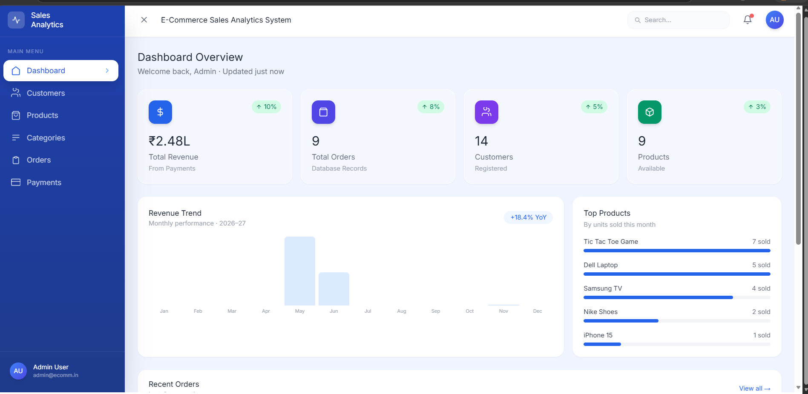
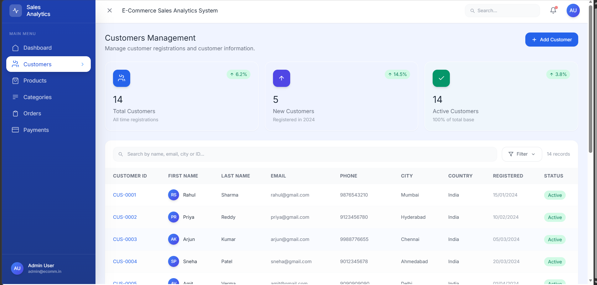
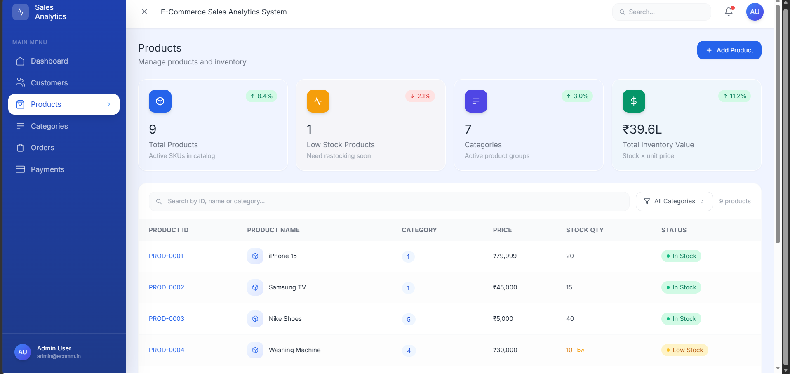
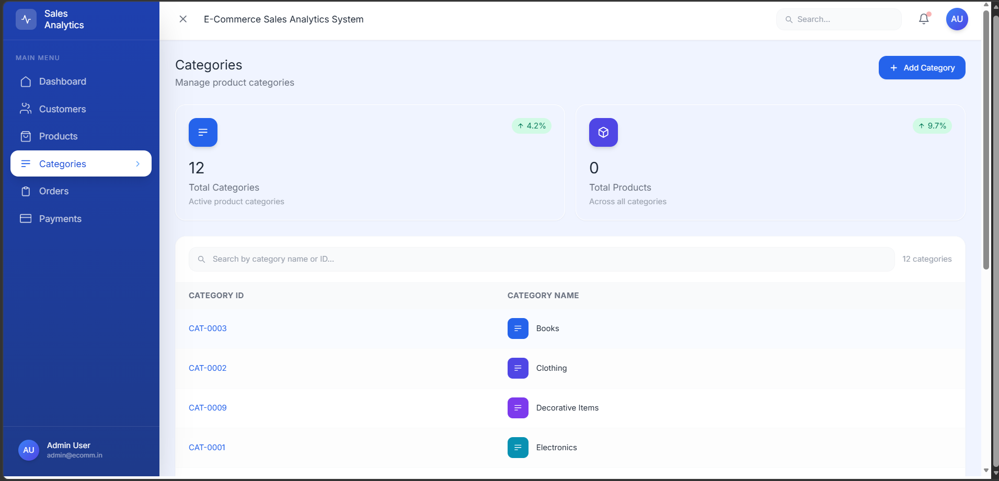
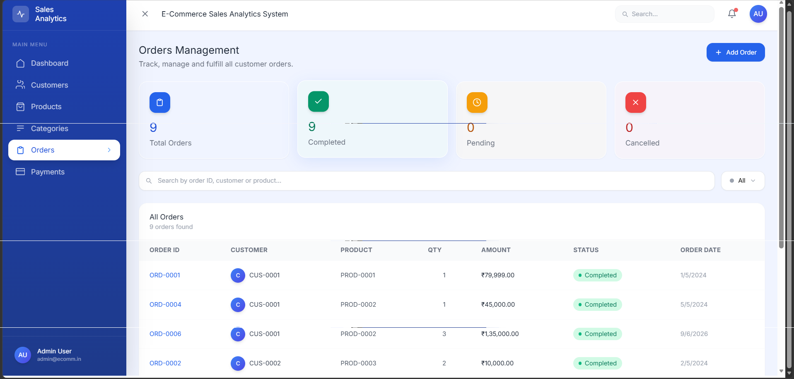
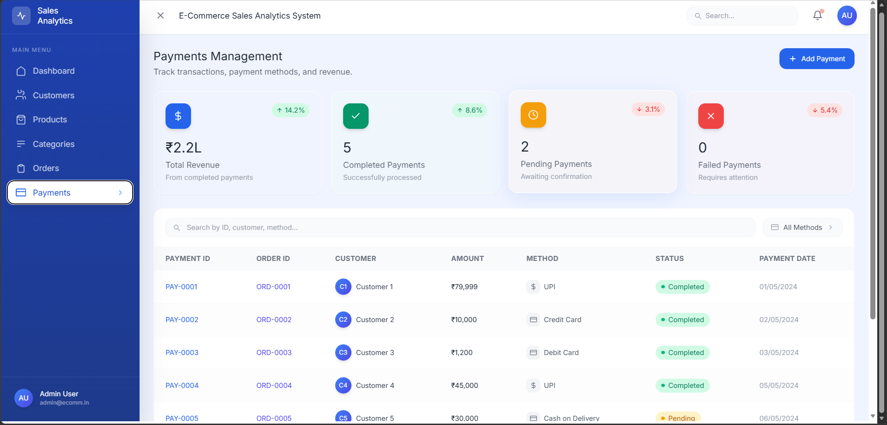

# E-Commerce Management System

A web-based E-Commerce Management System developed to manage customers, products, categories, orders, and payments. The application uses React.js for the frontend, Node.js and Express.js for the backend, and MySQL for database management.

## Features

- **Customer Management:** Add, view, and manage customer information.
- **Category Management:** Organize and manage product categories.
- **Product Management:** Add, view, update, and manage product details.
- **Order Management:** Manage customer orders and order information.
- **Payment Management:** Track payment details, payment methods, statuses, and amounts.
- **Database Integration:** Store and retrieve application data using MySQL.
- **REST API Integration:** Connect the frontend and backend using Axios.

## Technologies Used

| Technology | Purpose |
|---|---|
| React.js | Frontend development |
| HTML | Web page structure |
| CSS | Styling and layout |
| JavaScript | Application functionality |
| Node.js | Backend runtime |
| Express.js | Backend framework |
| MySQL | Relational database |
| Axios | HTTP requests and API communication |
| MySQL Workbench | Database management |

## Project Structure

```text
ecommerce-sales-analytics/
│
├── Backend/
│   └── backend/
│       ├── db.js
│       └── server.js
│
├── Ecommerce datasets csv/
│   ├── categories.csv
│   ├── customers.csv
│   ├── orders.csv
│   ├── payments.csv
│   └── products.csv
│
├── frontend/
│   ├── public/
│   │   ├── index.html
│   │   └── products.html
│   │
│   ├── src/
│   │   ├── api/
│   │   ├── App.js
│   │   ├── App.css
│   │   ├── index.js
│   │   └── index.css
│   │
│   ├── package.json
│   └── package-lock.json
│
├── README.md
├── package.json
└── package-lock.json
```

## Prerequisites

Make sure the following tools are installed:

- Node.js and npm
- MySQL Server
- MySQL Workbench
- Visual Studio Code
- Git

## Installation and Setup

### 1. Clone the Repository

```bash
git clone <your-github-repository-url>
cd ecommerce-sales-analytics
```

### 2. Set Up the Database

1. Open MySQL Workbench.
2. Create a database named `ecommerce_sales_db`.
3. Create the required database tables:
   - Customers
   - Categories
   - Products
   - Orders
   - Payments
4. Import the provided CSV datasets if required.
5. Configure your MySQL connection details in `Backend/backend/db.js`.

### 3. Start the Backend

Open a terminal in VS Code and execute:

```bash
cd Backend/backend
npm install
node server.js
```

The backend server runs at:

```text
http://localhost:5000
```

### 4. Start the Frontend

Open another terminal and execute:

```bash
cd frontend
npm install
npm start
```

The React application runs at:

```text
http://localhost:3000
```

Open the displayed URL in your browser to access the application.

## Database Modules

The application uses five main database tables:

| Table | Description |
|---|---|
| Customers | Stores customer information |
| Categories | Stores product categories |
| Products | Stores product details and prices |
| Orders | Stores customer order information |
| Payments | Stores payment details and transaction information |

## Datasets

The project includes CSV datasets for the following modules:

- `customers.csv`
- `categories.csv`
- `products.csv`
- `orders.csv`
- `payments.csv`

These datasets provide sample records for the e-commerce database.

## Screenshots








## Future Enhancements

- User authentication and authorization.
- Product search and filtering.
- Sales analytics and reporting dashboard.
- Order tracking and notifications.
- Enhanced reporting and data visualization.

## Author

Developed as an E-Commerce Management System project using React.js, Node.js, Express.js, and MySQL.
